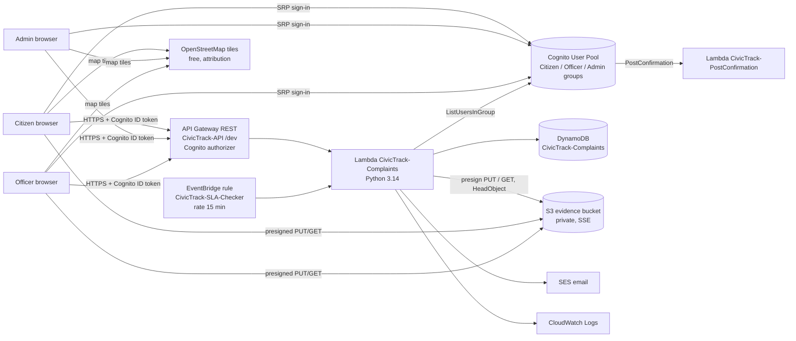
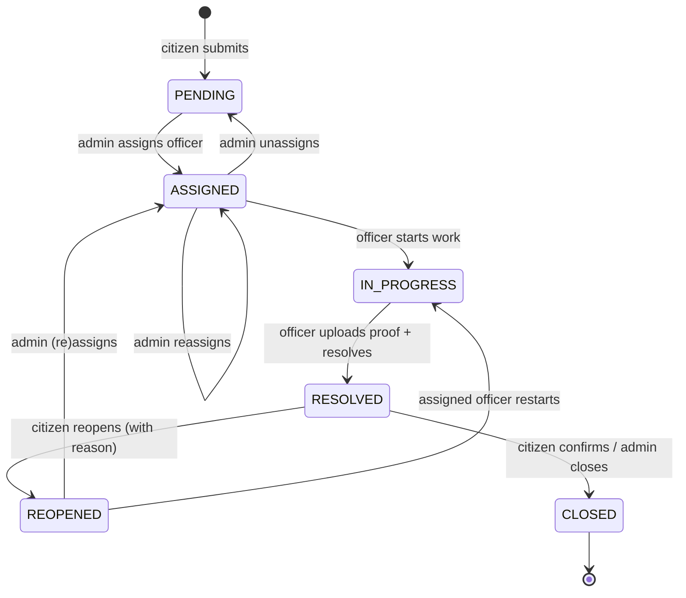

# CivicTrack — Architecture Overview

## System context

## Components

| Component | Responsibility |
|---|---|
| `frontend/` (React 19 + Vite 8) | Three role portals selected by the user's Cognito group: `CitizenPortal`, `AdminDashboard`, `OfficerDashboard`. Shared components for complaint detail, timeline, map, toasts, confirm dialog. Role checks in the UI are cosmetic; the backend is authoritative. |
| `backend/complaints/app.py` | Single Lambda: HTTP router, authentication context, role authorization, validation, complaint lifecycle state machine, S3 presigning, SES notifications, SLA sweep. |
| `backend/complaints/lifecycle.py` | Pure state-machine module (no AWS imports): statuses, allowed transitions, legacy status normalisation, department map, SLA computation. Unit-testable. |
| `backend/post_confirmation/app.py` | Adds confirmed self sign-ups to `Citizen`. |
| DynamoDB `CivicTrack-Complaints` | One item per complaint, including an append-only `history` list for audit. |
| S3 evidence bucket | `citizens/{sub}/complaint-evidence/*` and `officers/{sub}/complaints/{id}/proof/*`. Never public; access only via short-lived presigned URLs. |
| EventBridge | Invokes the same Lambda every 15 minutes with a scheduled event → `process_sla_checks()`. |

## Complaint lifecycle

Legacy rows: `PENDING` with a non-empty `assignedOfficerSub` is treated as `ASSIGNED` everywhere (API responses expose both `status` as stored and `effectiveStatus`). Every transition is executed as a DynamoDB conditional update whose condition repeats the expected prior state, so concurrent or duplicated requests fail with `409` instead of corrupting state.

## SLA automation

- Deadline = `createdAt + slaHours` (default 48 h). Warning window = final `SLA_WARNING_HOURS` (default 4 h).
- Sweep considers complaints whose effective status is not `RESOLVED`/`CLOSED`.
- **Claim-then-send**: the flag (`slaWarningSentAt` / `escalationNotifiedAt`) is set with a conditional write *before* sending. Only the invocation that wins the claim sends. If SES fails, the claim is released so the next run retries. This makes EventBridge duplicate delivery, Lambda retries and overlapping invocations safe.
- Officer email lookups are cached per sweep and only performed when a notification is actually due.
- All timestamps are stored as ISO-8601 UTC; naive timestamps are interpreted as UTC; unparseable timestamps are skipped and counted in the sweep summary.

## Security model

- Authentication: Cognito JWT validated by API Gateway; the Lambda reads only verified claims.
- Authorization (backend): Citizen → own complaints only; Officer → only complaints where `assignedOfficerSub == sub`; Admin → all. Enforced in list filters and re-checked on every single-item read and write.
- Evidence: private bucket; upload keys are generated server-side under the caller's prefix; images are verified (`HeadObject`: type allow-list, ≤10 MB) before being attached; view URLs expire after 300 s and are issued only to users allowed to see the complaint.

## Cost posture

Fully serverless, pay-per-request: no EC2, NAT, or always-on resources. Maps use free OpenStreetMap tiles via Leaflet (no paid map API). See `AWS_BUDGET_AUDIT.md`.
