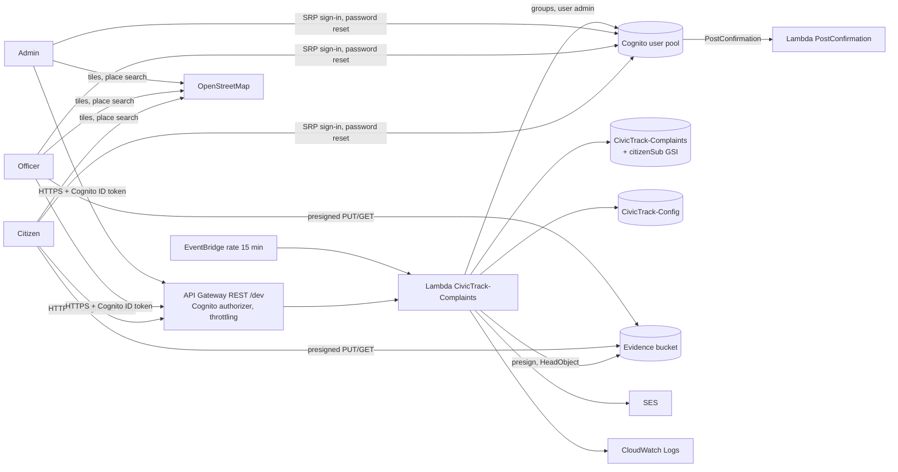

# CivicTrack — Architecture Overview

Updated 2026-11-10. Diagrams: `docs/UML_DIAGRAMS.md`; data model: `docs/DATABASE_SCHEMA.md`; endpoints: `docs/API_DOCUMENTATION.md`.

## System context

## Backend modules (`backend/complaints/`)

| Module | Responsibility | AWS calls |
|---|---|---|
| `app.py` | Router, authentication, role checks, validation, handlers, notifications, SLA sweep, audit | DynamoDB, S3, SES, Cognito |
| `lifecycle.py` | Statuses, transitions, legacy mapping, SLA state | none |
| `intelligence.py` | Rule-based category suggestion, priority score with reasons, extractive summary | none |
| `geo.py` | GeoJSON validation, point-in-polygon, haversine, hotspots | none |
| `analytics_engine.py` | Server-side aggregation | none |
| `reference.py` | Config-table access (departments, categories, zones, wards, officer profiles, settings, audit), 60 s cache, built-in fallback | DynamoDB (passed in) |

Pure modules have no AWS imports, so they are unit-tested directly.

## Frontend (`frontend/src/`)

React 19 + Vite. Portals are lazy-loaded per role. Shared pieces: `PortalShell` (navigation, notification centre), `ComplaintDetail`, `ComplaintMap` (Leaflet + OSM), `complaints.jsx` (data hook, filters, tables), `data.js` (reference data and notifications with offline fallbacks), `lib/` (API client, lifecycle mirror, analytics, geo, validation, assignment ranking). Role-based UI is cosmetic; the backend authorizes every call.

## Complaint lifecycle

Statuses: `PENDING → ASSIGNED → IN_PROGRESS → RESOLVED → CLOSED`, with `REOPENED` (citizen, ≤14 days, ≤3 times) and `REJECTED` (admin, final). Officers may accept or decline assignments and post progress updates. Admins may assign, reassign (before work), unassign, reject and escalate. Every transition:

1. reads the item consistently;
2. checks the transition table (`lifecycle.TRANSITIONS`);
3. writes with a condition that status and officer are unchanged since the read (optimistic concurrency → 409 on conflicts);
4. appends to the item's `history` (≤200 entries).

Legacy rows (`PENDING` + officer) are treated as `ASSIGNED`, so no migration is needed.

## Triage on submission

Category → department routing (config table, built-in fallback) → nearby open complaints of the same category within 200 m → priority score 0–100 from category base, risk keywords, nearby count and citizen urgency (reasons stored) → ward/zone by point-in-polygon against **imported** boundaries → extractive summary. All of this is deterministic and rule-based; no ML model or external AI service is used.

## SLA automation

Deadline = `slaStartedAt` (reopen) or `createdAt` + `slaHours` (from settings at creation, default 48). One notification per run per complaint, each guarded by a claim flag set with a conditional write **before** sending, and released if sending fails:

| Stage | Flag | Recipients |
|---|---|---|
| Warning (final `warningHours`, default 4) | `slaWarningSentAt` | officer + admins |
| Breach (`escalated = true` + history) | `escalationNotifiedAt` | officer + admins |
| Level 2 (24 h after deadline) | `escalationLevel2NotifiedAt` | admins |

Safe under EventBridge duplicate delivery, Lambda retries and overlapping runs; per-record errors never abort the sweep.

## Security model (summary)

Cognito JWT validated by API Gateway; role from `cognito:groups` only. Citizens see only their own complaints (404 for others); officers only assigned ones (403); admin routes call `require_admin`. Evidence keys are server-generated per user and verified with `HeadObject`; URLs expire in 300 s. Cognito admin actions are IAM-scoped to this user pool. Details: `docs/SECURITY_ARCHITECTURE.md`.

## Data and cost posture

Two on-demand DynamoDB tables, one private S3 bucket, no always-on compute. Full-table scans (admin lists, SLA sweep, analytics, admin feed, duplicate checks) are the dominant cost driver at scale; mitigations are listed in `AWS_COST_ESTIMATE.md`. Maps use free OpenStreetMap services under their usage policies.
