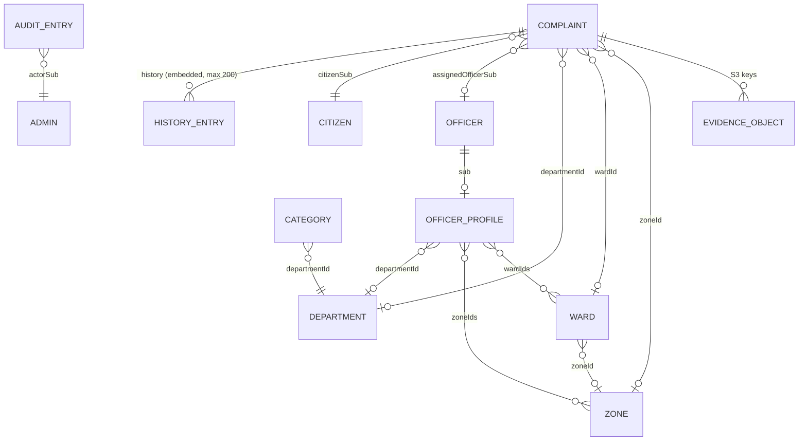

# CivicTrack Database Schema

Two DynamoDB tables (on-demand, SSE) plus one private S3 bucket. Every change in this iteration is **additive**: existing complaint items need no migration, and the old code ignores the new attributes.

## Data model (ER view)



`CITIZEN`, `OFFICER` and `ADMIN` are Cognito users (groups `Citizen`, `Officer`, `Admin`), identified by their immutable `sub`.

## Table 1 — `CivicTrack-Complaints` (existing)

| Key | |
|---|---|
| PK `complaintId` (S) | `CT-` + 10 uppercase hex |
| **GSI `citizenSub-createdAt-index`** (new) | HASH `citizenSub`, RANGE `createdAt`, projection ALL — every existing item has both attributes, so the online backfill is complete |

| Attribute | Type | Set by | Notes |
|---|---|---|---|
| title, category, location, description | S | create | 150/60/250/3000 chars |
| **summary** | S | create | extractive (title + first sentence) |
| latitude, longitude, locationAccuracy | N | create | optional |
| landmark | S | create | |
| photoKey | S | create | `citizens/{sub}/complaint-evidence/…` |
| citizenSub, citizenEmail | S | create | from verified JWT only |
| **citizenUrgency** | S | create | LOW/MEDIUM/HIGH (citizen's view) |
| status | S | lifecycle | PENDING, ASSIGNED, IN_PROGRESS, RESOLVED, REOPENED, CLOSED, **REJECTED** |
| priority, **priorityScore**, **priorityReasons** | S, N, L | create/admin/escalate | rule-based score 0–100 with reasons |
| department, **departmentId** | S | create/admin | routed from category |
| zone, ward, **zoneId**, **wardId** | S | create (point-in-polygon) / admin | names kept for display & legacy |
| **suggestedCategory**, **nearbyOpenCount** | S, N | create | triage signals |
| assignedOfficerSub, assignedOfficerName, assignedAt, assignedBySub | S | assign | `""` when unassigned |
| **acceptedAt**, **declinedAt** | S | officer | |
| unassignedAt | S | admin | |
| workStartedAt, beforePhotoKey | S | start | |
| **progressPhotoKeys** (≤10), **percentComplete**, **lastProgressAt** | L, N, S | progress | |
| resolvedAt, resolvedBySub, proofPhotoKey, resolutionNote | S | resolve | |
| reopenedAt, reopenCount, slaStartedAt | S, N, S | reopen | SLA restarts at reopen |
| closedAt, closedByRole, citizenRating, **citizenFeedback** | S, S, N, S | close | |
| **rejectedAt**, **rejectionReason**, **duplicateOf** | S | reject | |
| createdAt, slaHours | S, N | create | `slaHours` from settings at creation |
| escalated, escalatedAt, **escalationLevel** | BOOL, S, N | SLA sweep / admin | |
| slaWarningSentAt, escalationNotifiedAt, **escalationLevel2NotifiedAt** | S | SLA sweep | one-time claim flags |
| lastCitizenNotification | M | notifications | `{kind, sent, at}` |
| history | L of M | every action | `{at, action, actorRole, actorSub, fromStatus, toStatus, note?, officerName?, previousOfficerName?, level?, percentComplete?}` |
| updatedAt | S | admin | |

## Table 2 — `CivicTrack-Config` (new)

PK `pk` (S), SK `sk` (S).

| pk | sk | Attributes |
|---|---|---|
| `DEPT` | departmentId | name, description, active, createdAt/updatedAt |
| `CATEGORY` | category name | departmentId, active |
| `ZONE` | zoneId | name, active, boundaryJson, bboxJson, boundaryVertices, boundarySource |
| `WARD` | wardId | name, number, zoneId, active, boundaryJson, bboxJson, boundaryVertices, boundarySource |
| `OFFICER` | Cognito sub | departmentId, zoneIds, wardIds, available, maxActive |
| `SETTINGS` | `global` | slaHours, warningHours, maxComplaintsPerHour, discloseOfficerName |
| `AUDIT#YYYY-MM` | `<iso time>#<id>` | at, actorSub, actorRole, action, target, details (JSON, ≤4 KB) |

Boundaries are stored as JSON strings (≤300 KB, keeping items under DynamoDB's 400 KB limit). When no `DEPT` items exist the API serves CivicTrack's built-in departments with `source: "builtin"`; the first admin edit persists them.

## Access patterns

| Pattern | Implementation |
|---|---|
| Citizen's complaints, citizen hourly rate check | Query GSI `citizenSub-createdAt-index` (scan fallback until deployed) |
| Officer's complaints | Scan + filter `assignedOfficerSub` (an officer GSI is deliberately avoided: existing items hold `""`, which DynamoDB rejects as an index key) |
| Admin list | Scan (all) or paginated scan (`limit`/`nextToken`) |
| Single complaint, all transitions | GetItem (consistent) + conditional UpdateItem guarded on status and officer |
| Duplicate/nearby check | Scan of open items with coordinates (see cost notes) |
| SLA sweep | Scan filtered to open statuses |
| Analytics | Scan with projection, aggregated in Lambda |
| Reference data | Query by `pk` (cached 60 s per Lambda container) |
| Audit month | Query `AUDIT#YYYY-MM`, newest first |

## S3 layout (private bucket, server-generated keys)

```
citizens/{citizenSub}/complaint-evidence/{uuid}.{jpg|png|webp}
officers/{officerSub}/complaints/{complaintId}/before/{uuid}.{ext}
officers/{officerSub}/complaints/{complaintId}/progress/{uuid}.{ext}
officers/{officerSub}/complaints/{complaintId}/proof/{uuid}.{ext}
```
