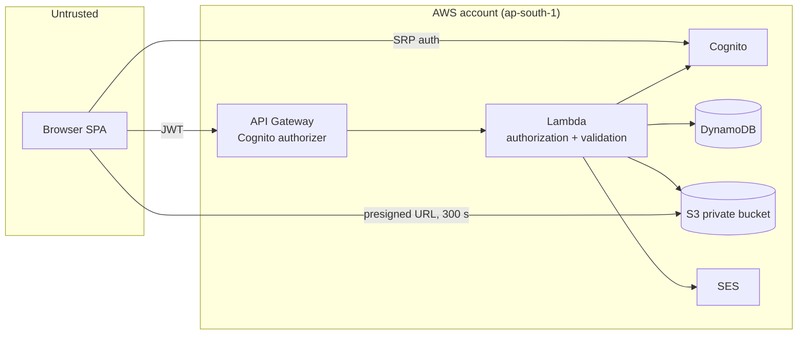

# CivicTrack Security Architecture

## Trust boundaries

Everything the browser sends is treated as untrusted, including its idea of the user's role.

## Controls

| Concern | Control | Where |
|---|---|---|
| Authentication | Cognito user pool, email verification, strong password policy; API Gateway validates JWT on every non-health route | `template.yaml` |
| Role-based authorization | Role from `cognito:groups` claim only; each handler checks role; frontend role routing is cosmetic | `authenticate_request`, each handler |
| Citizen isolation | List filtered by `citizenSub`; detail/reopen/close return **404** for others' complaints | `can_view`, `require_complaint_access` |
| Officer isolation | List filtered by `assignedOfficerSub`; every officer action re-reads the item and compares `assignedOfficerSub`; 403 otherwise | `update_officer_workflow`, upload URL |
| Admin-only actions | assign, reassign, unassign, metadata update, officer directory | each handler |
| Assignment integrity | Officer must be an enabled member of the Cognito `Officer` group; display name taken from Cognito, not the request | `assign_complaint` |
| Lifecycle integrity | Transition table + conditional writes on the previously read `status` and `assignedOfficerSub`; stale/concurrent requests get 409 | `lifecycle.py`, `apply_transition` |
| Duplicate requests | `clientRequestId` idempotency for create; transitions are naturally idempotent (second call → 409) | `create_complaint` |
| Input validation | Type, length, control-character, enum and range checks; complaint ID regex; JSON-object bodies only | `parse_body`, `optional_text`, `parse_coordinate` |
| File uploads | Content-type allow-list (JPEG/PNG/WebP); ≤10 MB checked in browser and by `HeadObject` after upload; server-generated keys under the caller's prefix; traversal/URL rejection | `validate_uploaded_image` |
| S3 privacy | Block Public Access (all four), BucketOwnerEnforced, SSE-S3; access only via presigned URLs (PUT and GET expire in 300 s) | template, `create_presigned_*` |
| Secrets | No AWS credentials in frontend; `.env.production` holds public IDs only; Lambda uses its execution role | — |
| Error handling | Generic 500 body; exception type only in logs | `lambda_handler` |
| Logging & privacy | Recipient email addresses no longer logged (message IDs only); complaint IDs and counts logged | `send_notification` |
| Audit trail | Append-only `history` per complaint (actor role, actor sub, transition, note, time) | `history_entry` |
| SLA automation safety | Claim-then-send conditional flags; per-record error isolation; malformed timestamps skipped and counted | `process_sla_checks` |
| Least privilege IAM | Table/index ARNs only; `DeleteItem` removed; S3 `Get/PutObject` on bucket objects only; SES send only; Cognito `ListUsersInGroup` only | template |
| CSV export | Formula-injection neutralised | `lib/analytics.js` `csvCell` |
| Local demo auth | Accepted only when `AWS_SAM_LOCAL=true` **and** `ENABLE_LOCAL_DEMO_AUTH=true` (backend) and `import.meta.env.DEV` (frontend); test proves headers are ignored when deployed | `test_local_demo_headers_rejected_when_deployed` |

## Residual risks and recommendations

| Risk | Recommendation | Owner action |
|---|---|---|
| CORS origin `*` | Set `AllowedOrigin` to the hosted frontend origin | deploy parameter |
| Logs kept forever | 30-day retention | CLI command (guide §6) |
| No backups | Enable PITR | billing approval |
| `ALLOW_USER_PASSWORD_AUTH` enabled | Remove from app client after confirming no client uses it | deploy |
| SES sandbox | Production access | AWS request |
| Presigned PUT cannot cap size at upload time | Size verified after upload; orphaned objects possible. A presigned POST policy with `content-length-range` would enforce at upload | future change |
| No WAF / throttling plan | API Gateway default account throttling applies; add usage plan or WAF before public launch | cost decision |
| Cognito sub list scan for officer lookup | Fine for tens of officers; cache or store officer profile for hundreds | future change |
