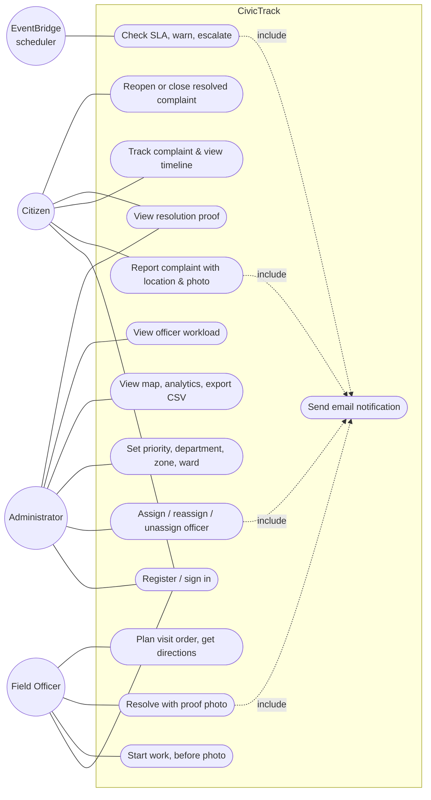
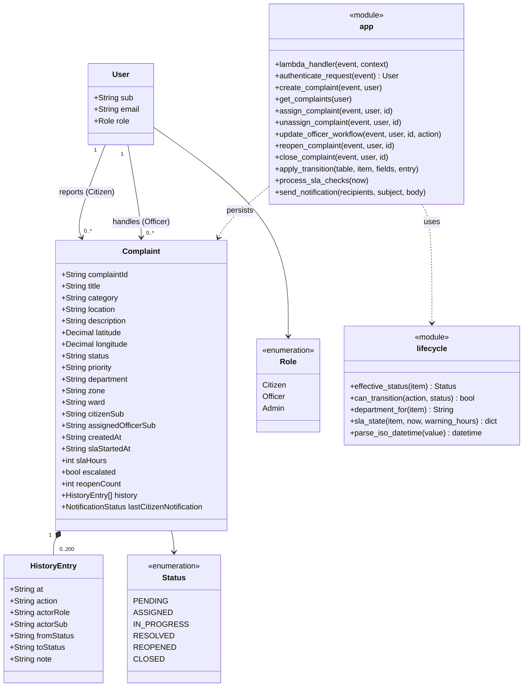
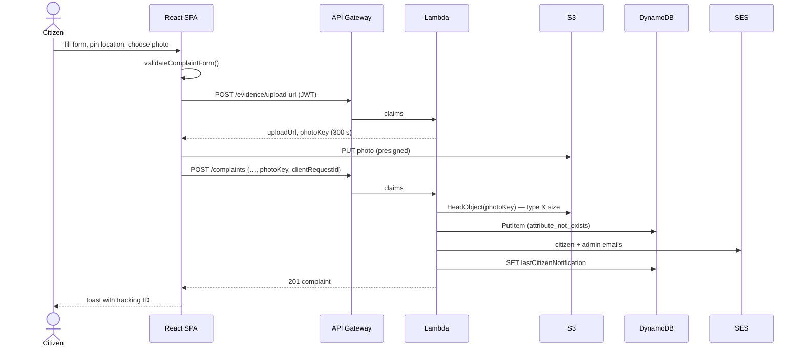
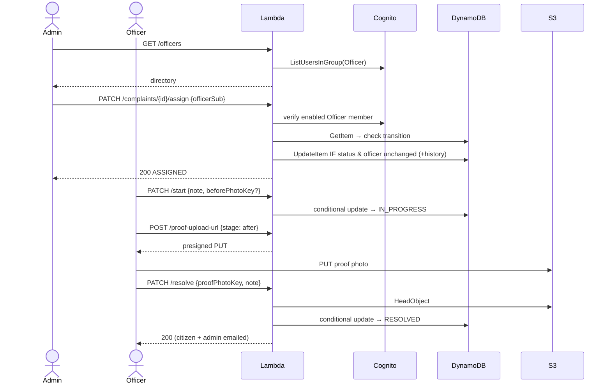
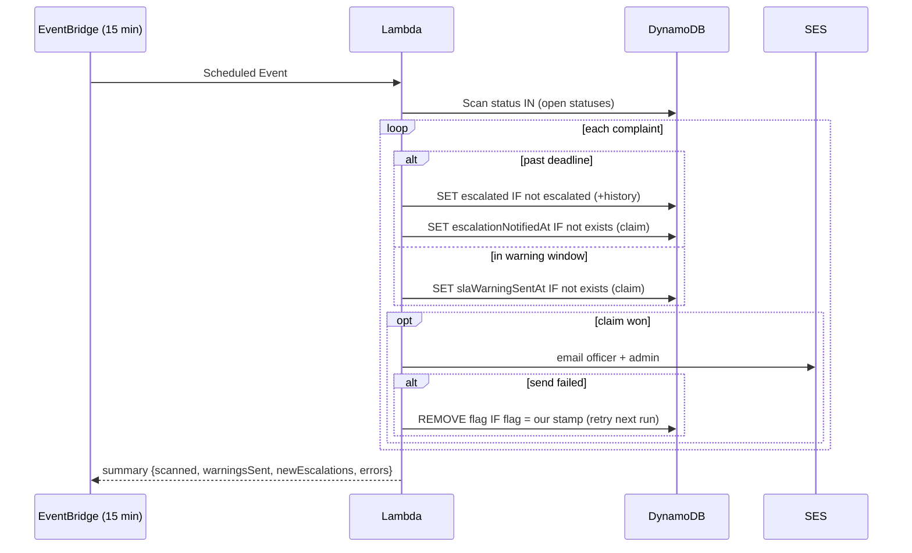
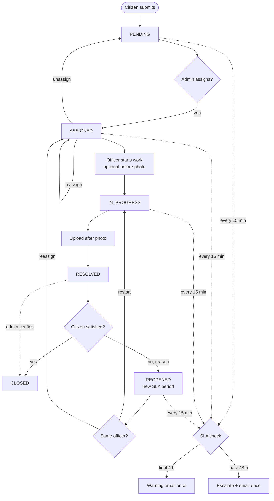
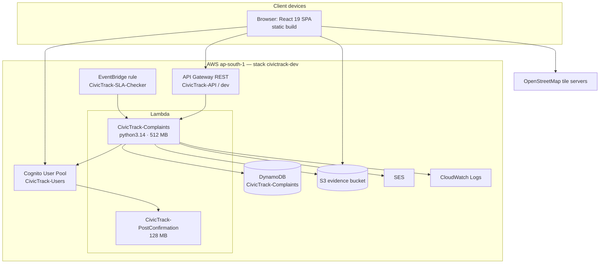
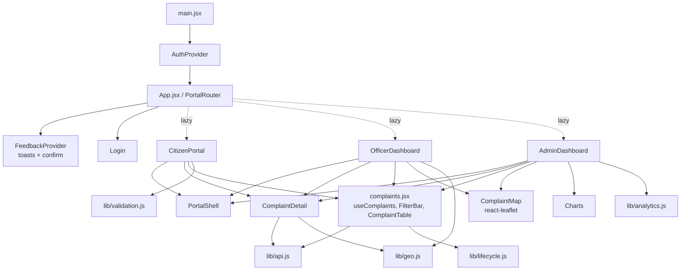
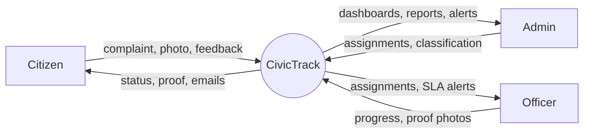
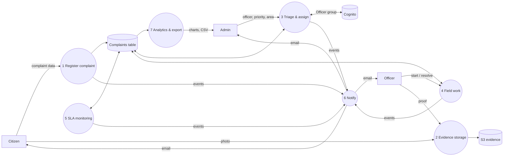

# CivicTrack UML & Architecture Diagrams

All diagrams are Mermaid (render on GitHub, VS Code, or mermaid.live) and reflect the code as of 2026-11-09. Names match identifiers in `backend/complaints/app.py`, `lifecycle.py` and `frontend/src`.

## 1. Use case diagram

## 2. Class diagram (domain + backend modules)

## 3. Sequence — citizen submits a complaint with photo

## 4. Sequence — assignment, work and resolution

## 5. Sequence — SLA sweep (idempotent)

## 6. Activity diagram — complaint lifecycle

## 7. Deployment diagram

## 8. Component diagram (frontend)

## 9. Data flow diagrams

### Level 0 (context)

### Level 1

