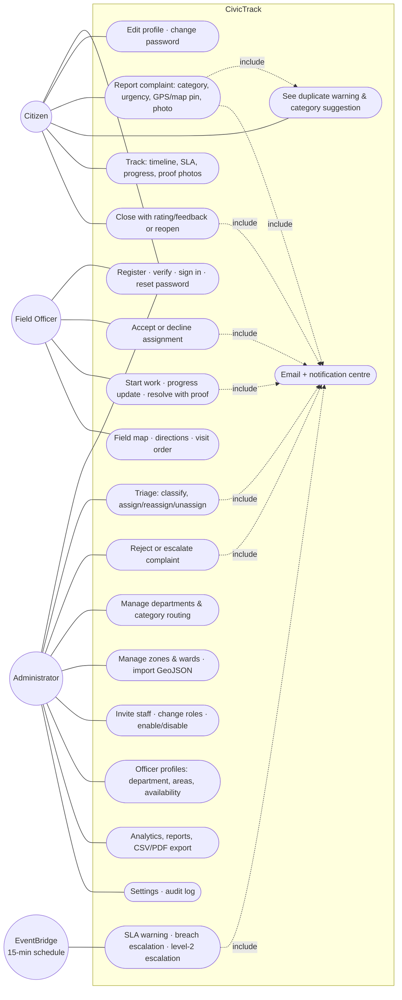
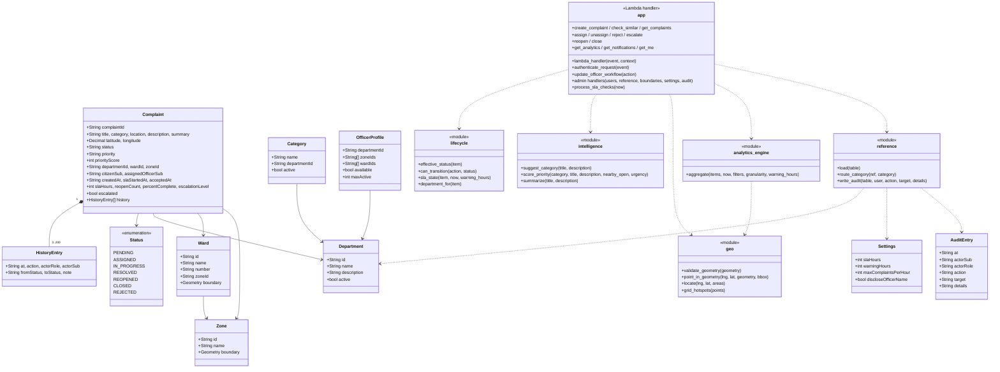
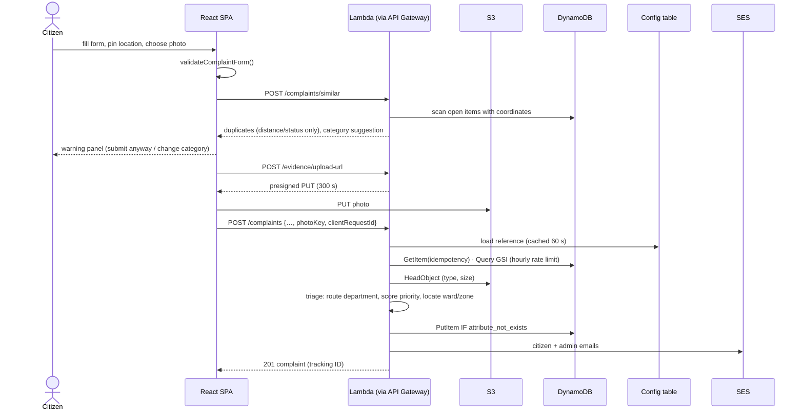
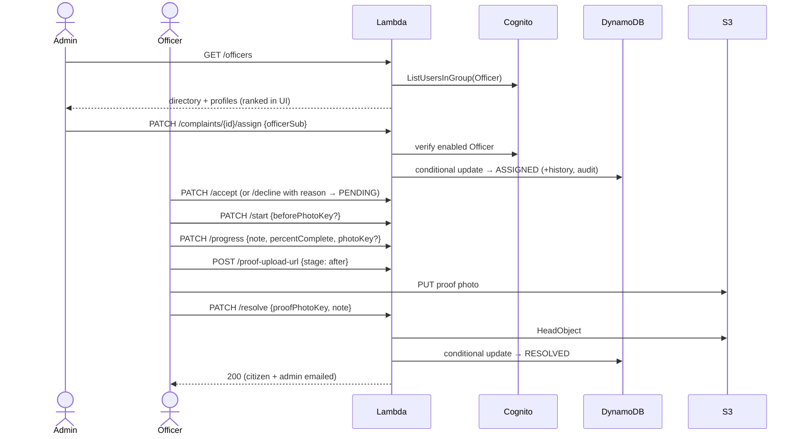
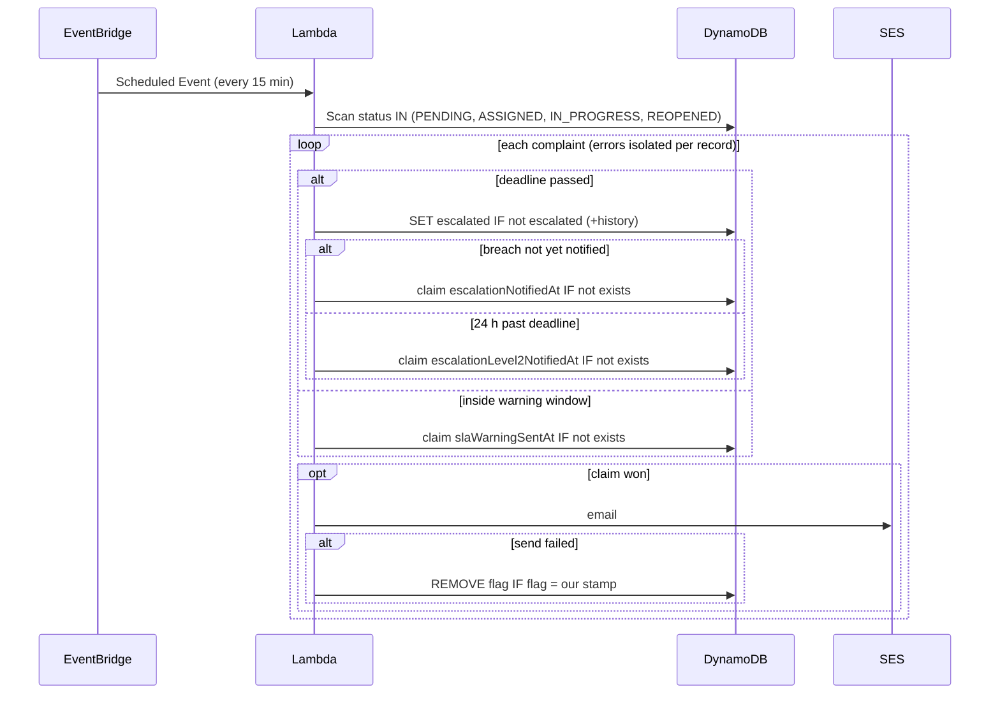
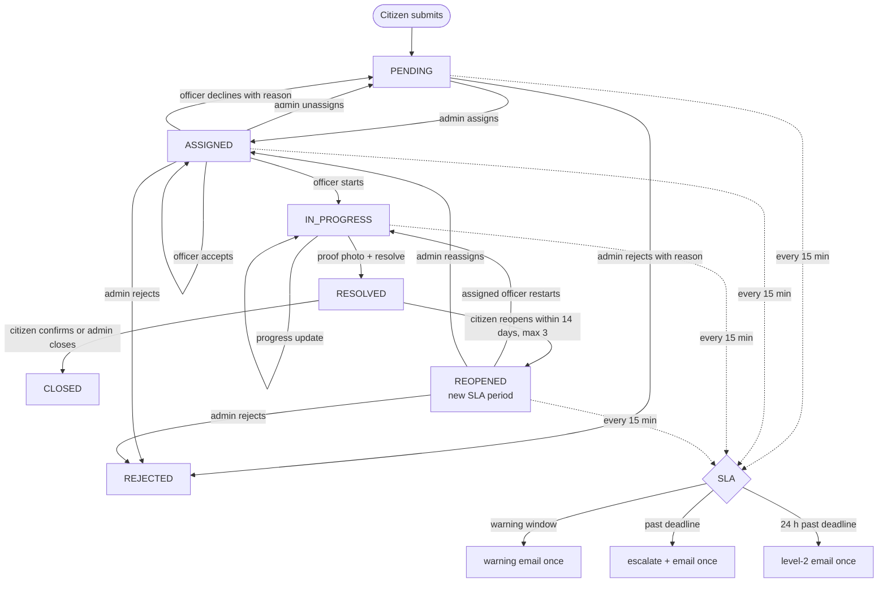
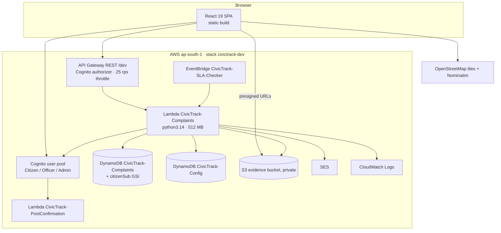
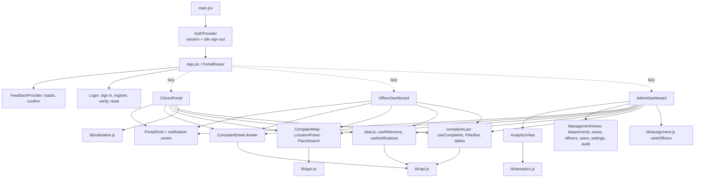
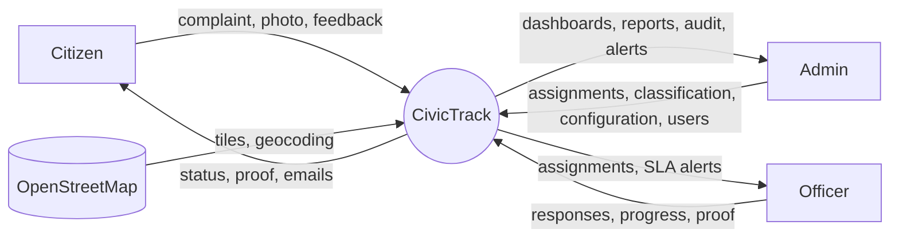
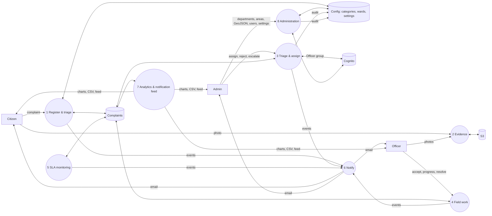

# CivicTrack UML & Architecture Diagrams

Mermaid diagrams (render on GitHub, VS Code or mermaid.live), reflecting the code on 2026-11-10. Identifiers match `backend/complaints/*.py`, `infrastructure/template.yaml` and `frontend/src`. The ER/data-model diagram is in `DATABASE_SCHEMA.md`.

## 1. Use case diagram

## 2. Class diagram (domain and backend modules)

## 3. Sequence — citizen submits a complaint

## 4. Sequence — assignment and field work

## 5. Sequence — SLA sweep (idempotent)

## 6. Activity diagram — complaint lifecycle

## 7. Deployment diagram

The config table, citizen GSI, new routes and throttling are defined in `infrastructure/template.yaml` but **not yet deployed** (see `DEPLOYMENT_GUIDE.md` §3).

## 8. Component diagram (frontend)

## 9. Data flow diagrams

### Level 0

### Level 1

